
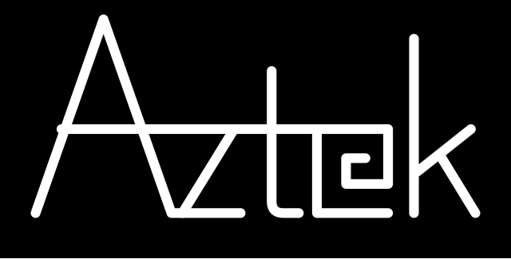

A modelling, UV, rigging and animation application that behaves like Maya. Rust core (scene graph, commands,
geometry, Vulkan viewport), Qt Widgets shell in C++, a MEL interpreter, and embedded Python with `aztek.cmds`, a
`maya.cmds` shim and an OpenMaya API 2.0 subset. Reads and writes `.ma` files. [PARITY.md](PARITY.md) has the behaviour
target and status, including where it differs from Maya; [docs/COMMANDS.md](docs/COMMANDS.md) lists all 962 commands.

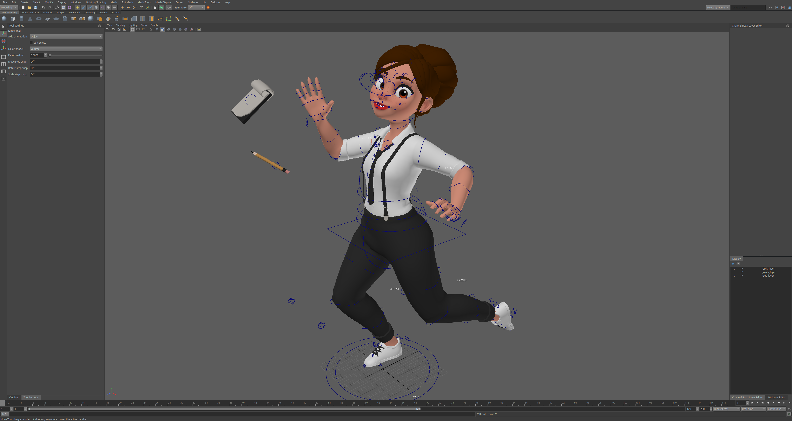

A production character rig made in Maya 2020, opened from its `.ma` file and posed: 414 joints, 37 skinClusters, 17
blendShapes, 82 IK handles, follicles, ribbons and wires. It opens in about 3 seconds and responds in 13 to 44 ms per change.

## What's in it

- **Polygon modelling:** Maya's polygon commands with construction history; Quad Draw, Multi-Cut, Insert and Offset Edge
  Loop, Target Weld, Slide Edge, Crease, Create and Append Polygon; symmetry, soft selection; eighteen sculpting brushes.
- **NURBS:** curves (CV and EP tools, rebuild, attach, detach, offset) and surfaces (primitives, loft, revolve, extrude,
  boundary, birail, `nurbsToPoly`), with CVs as components.
- **UVs:** projections, unfold, layout, cut and sew, UV Editor.
- **Materials and textures:** lambert, blinn, phong, phongE and surfaceShader with file textures and place2dTexture, assigned to objects or faces; Textured mode (6) in the viewport; Hypershade lists; the image behind the UV Editor.
- **Rigging:** joints (orient, mirror, insert, segment scale compensate), RP, SC and spline IK, every constraint, smooth
  skin with weight painting, mirror and copy, dual quaternion; lattice, wrap, wire, delta mush, softMod, nonlinears,
  clusters, blend shapes; a HumanIK subset (skeleton, definition, control rig, retargeting).

  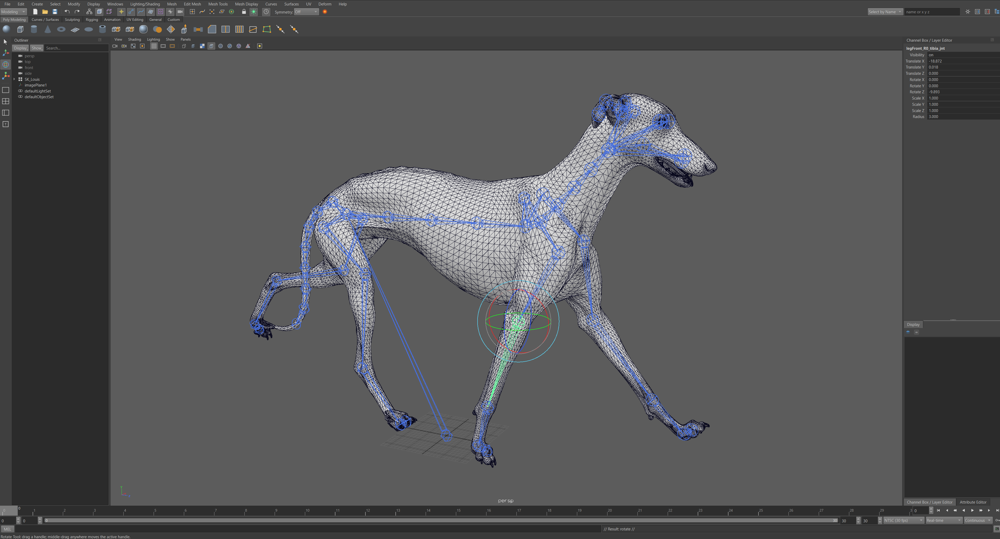
- **Animation:** keys with weighted tangents and infinities, Graph Editor, Dope Sheet, set driven keys, breakdowns,
  copy and paste keys, baking, motion paths, animation layers, character sets and clips.
- **Deformers:** blendShape in full (Shape Editor, in-between and live targets), sculpt, jiggle, shrinkWrap, proximityWrap,
  curveWarp, wrinkle, morph and more; deformer weights painted with the Paint Attribute tool or exported.
- **Files:** `.ma` read and written in Maya's layout, deformer chains, constraints, utility nodes, expressions, materials,
  NURBS and references with their edits included; namespaces, instances, locked nodes, Z up.

  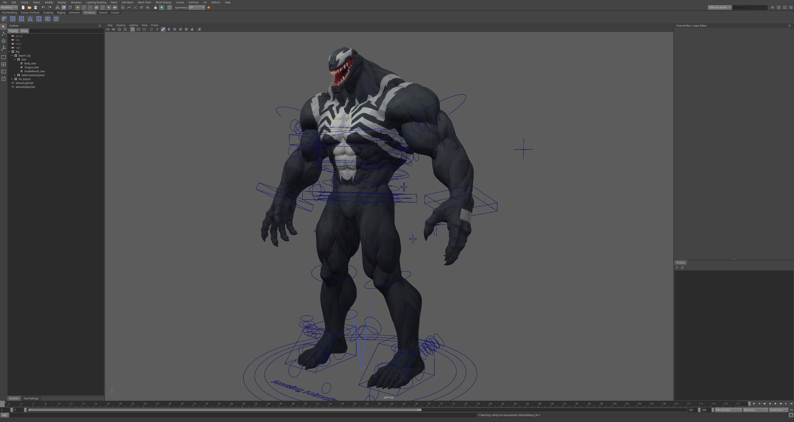
- **Scripting:** MEL (procedures, arrays, control flow, backticks), Python, `maya.api.OpenMaya`, Python plug-ins with
  `MPxCommand` and `MPxNode`; `scriptJob`, `scriptNode` and `evalDeferred`.
- **Script-built interface:** `window`, layouts, controls, menus and dialogs from MEL or Python become Qt widgets;
  attribute-bound controls, `AE<type>Template` procedures, `workspaceControl` docking, editors and panels created by script.
- **Playblast** to images or, through ffmpeg, to a movie.
- **Interface:** menu sets, shelves with an editor, hotkey editor, marking menus, hotbox, channel box, outliner, attribute
  editor, node editor, tool settings, panel layouts, workspaces.

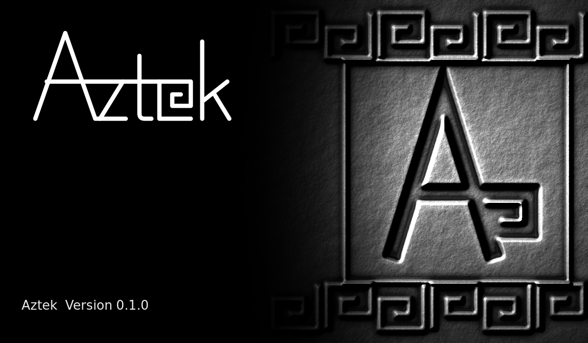

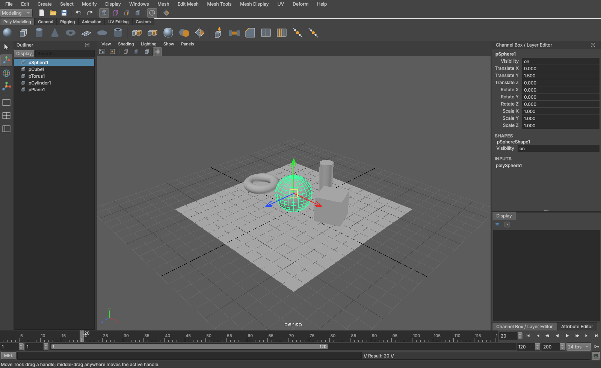

## Screens

Four views, Space to toggle:

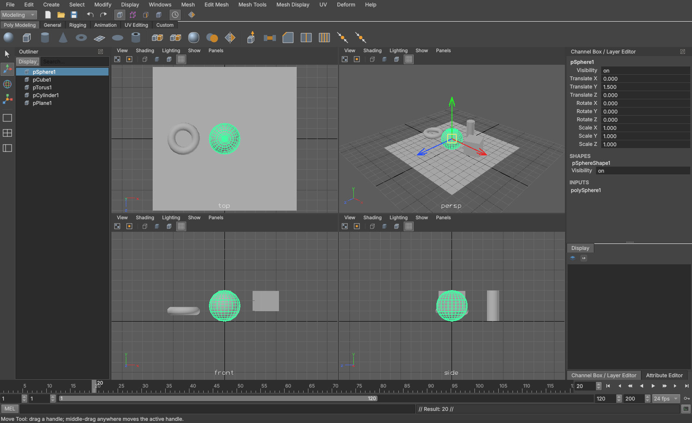

Component editing with construction history (`polyExtrudeFace1` in the channel box's inputs) and the move manipulator:

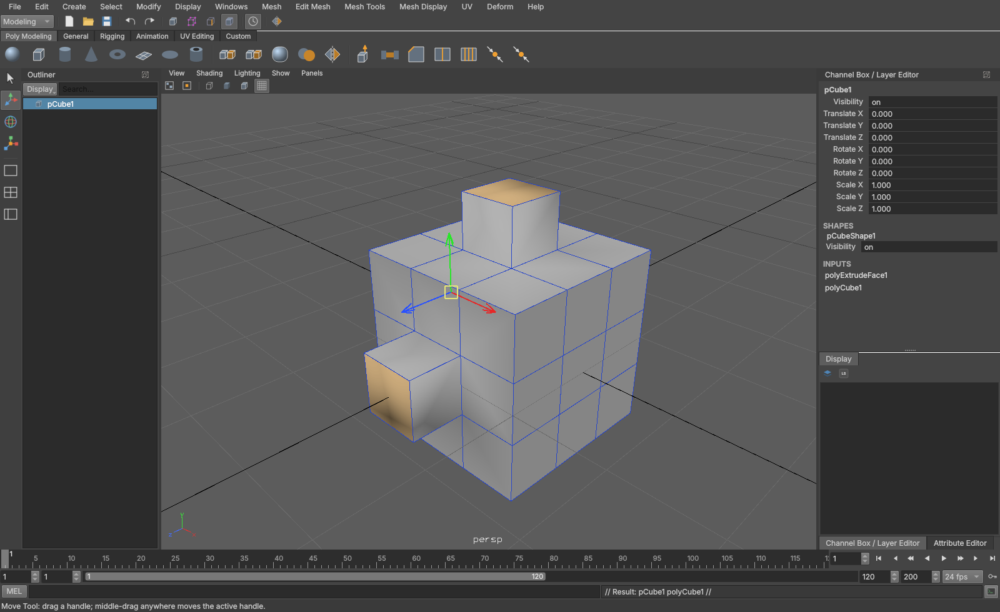

Marking menus on the right button:

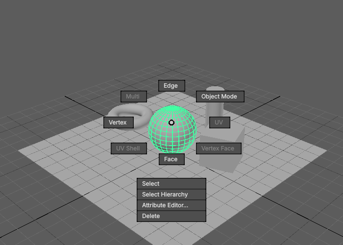

Soft selection (B), falloff shown on the vertices:

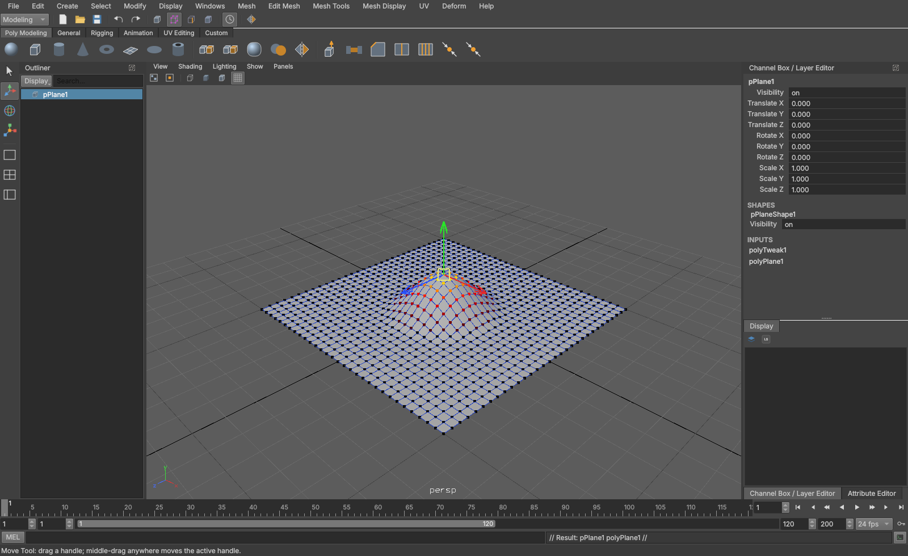

UV Editor: automatic projection and layout:

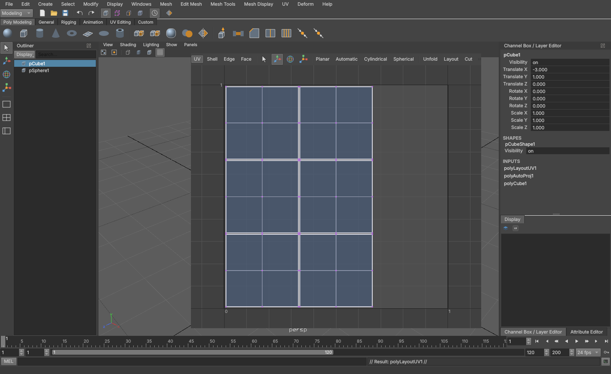

Graph Editor, with keyed channels in the channel box and key ticks on the time slider:

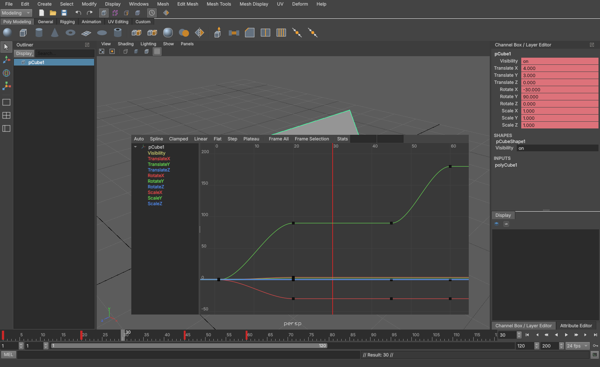

The production rig in another pose, its controls driving joints, skin and blend shapes:

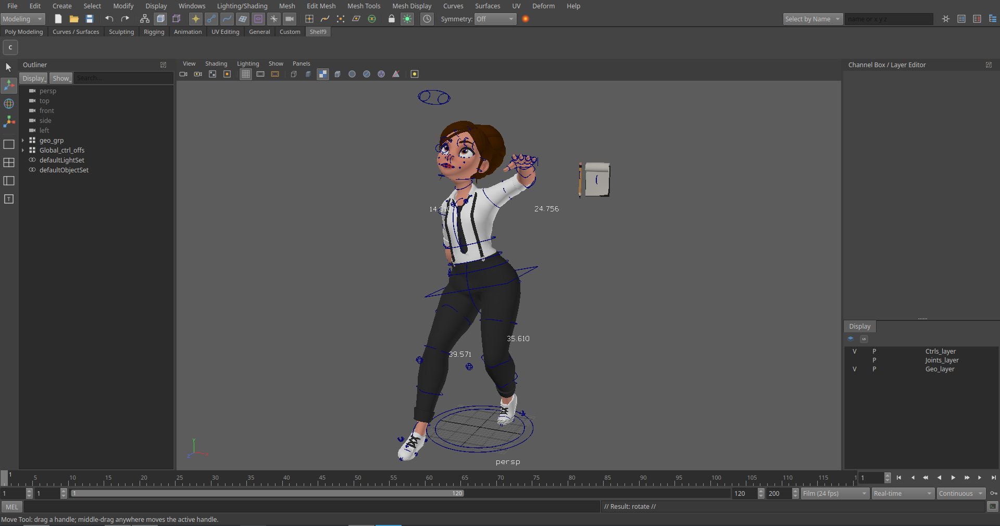

Joints, smooth skin and an RP IK handle:

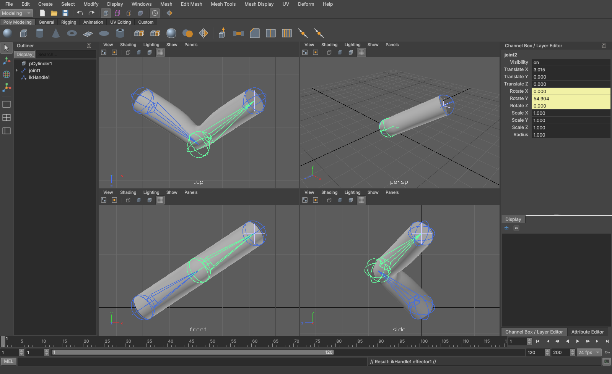

Paint Skin Weights, with the influence list and brush settings in Tool Settings:

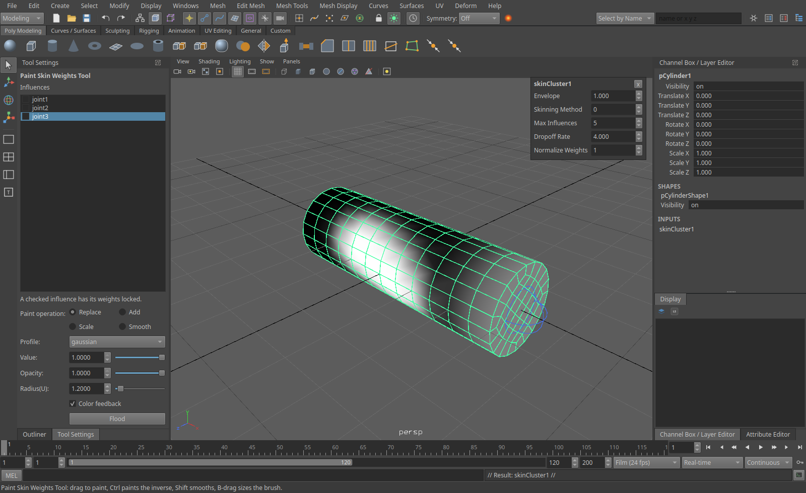

NURBS surfaces and curves, with a drawing override on the control:

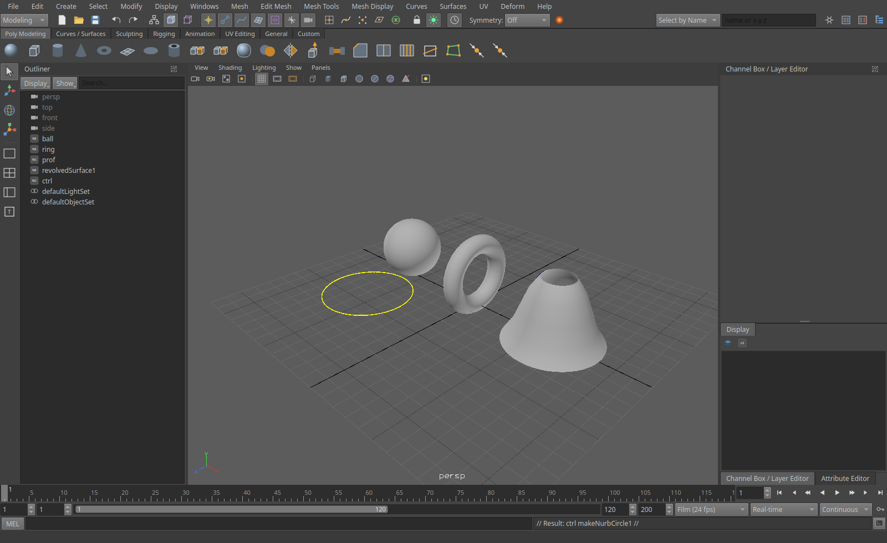

Quad Draw on a live surface:

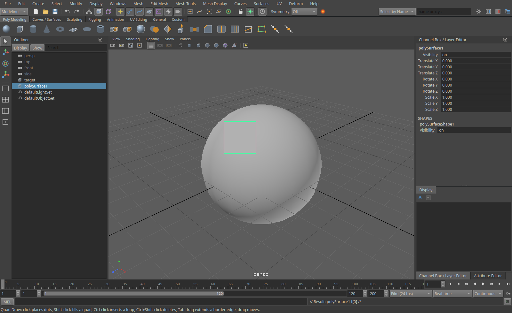

Dope Sheet, with a breakdown in green:

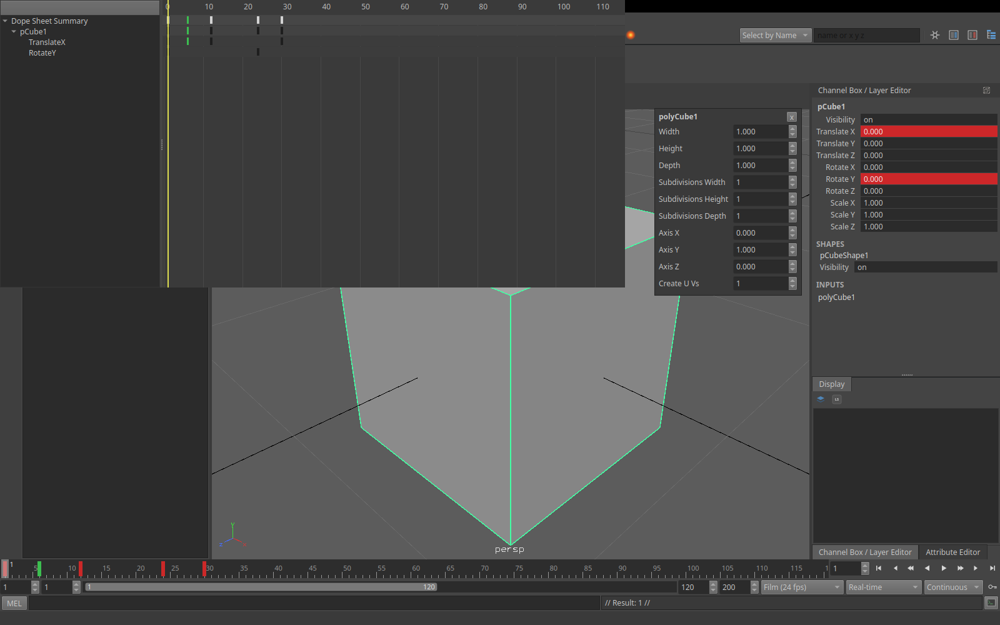

Node Editor:

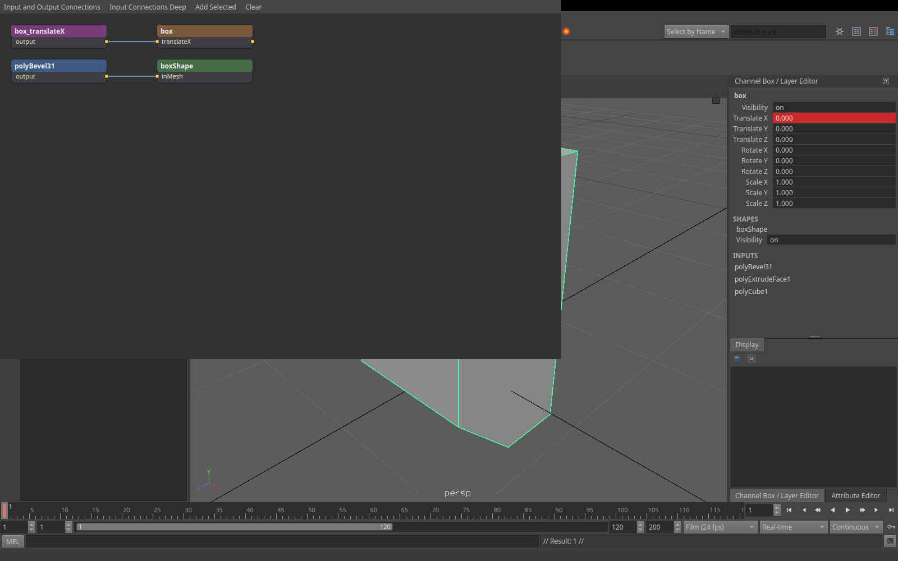

## Install

Packages are on the [releases page](https://github.com/srlegrand/AKA-Crest-Aztek/releases): `latest` follows main.

| System | Package | Install |
| --- | --- | --- |
| Rocky Linux 8 | `aztek-<version>-1.el8.x86_64.rpm` | `sudo dnf install ./aztek-*.el8.x86_64.rpm` (Qt is bundled) |
| Rocky Linux 9 | `aztek-<version>-1.el9.x86_64.rpm` | `sudo dnf install epel-release`, then `sudo dnf install ./aztek-*.el9.x86_64.rpm` |
| Ubuntu 22.04, 24.04 | `aztek_<version>-1_ubuntu22.04_amd64.deb`, `..._ubuntu24.04_...` | `sudo apt install ./aztek_*.deb` |
| Windows 10 and 11 | `aztek-<version>-setup-x64.exe`, or the zip | Run it. It isn't signed, so SmartScreen asks first |

The viewport needs a Vulkan driver: NVIDIA's own driver has one, and Mesa's `mesa-vulkan-drivers` covers AMD and Intel.
[docs/PACKAGING.md](docs/PACKAGING.md) has the details, and how the packages are built.

## Build

Linux:

    ./build.sh --deps --run

`--deps` installs the build dependencies (apt, dnf or pacman) and only needs running once; `--run` starts Aztek
afterwards; `--install` puts it in `~/.local` with a menu entry and icon; `--debug` builds into `build-debug/`. Rust comes from [rustup](https://rustup.rs). An active conda
environment is fine: the script builds against the system Python and ignores conda's libraries.

Windows, from PowerShell or a command prompt:

    build.bat -Run

Needs Visual Studio 2022 (or its Build Tools) with "Desktop development with C++", Rust from
[rustup](https://rustup.rs), CMake, Qt 6.4+ for MSVC from the [Qt online installer](https://www.qt.io/download-qt-installer-oss),
and Python 3 from [python.org](https://www.python.org/downloads/). The script finds Visual Studio and the newest Qt
under `C:\Qt` (or takes `-Qt C:\Qt\6.8.0\msvc2022_64`), builds, and makes a folder that runs by itself in `build\dist`:
Qt's DLLs, the VC runtime and Python's standard library beside `aztek.exe`.

By hand, on either: `cmake -B build -G Ninja -DCMAKE_BUILD_TYPE=Release && cmake --build build`. The first build
compiles the Rust core (a few minutes); later builds only rebuild what changed. `-DAZTEK_PYTHON=OFF` builds without
Python.

Options:

    aztek [scene.aztek|scene.ma] [--script file.mel|file.py] [--screenshot out.png]

On KDE Plasma, Alt + drag moves windows by default: set System Settings > Window Management > Window Behavior >
Window Actions > Modifier key to Meta, as for Maya.

## Hotkeys

| Keys | Action |
|---|---|
| Alt + left / middle / right drag, wheel | Tumble, track, dolly |
| Space tap / hold | Toggle single and four views / hotbox |
| Right button | Marking menu (Shift: modelling tools, Ctrl: selection conversion) |
| Q W E R | Select, move, rotate, scale |
| F / A, Shift+F / Shift+A | Frame selection / all, in every view |
| F8, F9, F10, F11 | Object/component, vertex, edge, face |
| F2, F3, F4 | Animation, Modeling, Rigging menu sets |
| Click, drag, double-click an edge | Select, marquee, edge loop |
| Shift / Ctrl / Ctrl+Shift click | Toggle / deselect / add |
| Z, Shift+Z (Ctrl+Z, Ctrl+Y) | Undo, redo |
| G | Repeat last |
| Ctrl+D, Shift+D, Ctrl+G, P, Shift+P | Duplicate, duplicate with transform, group, parent, unparent |
| Ctrl+E, Ctrl+B | Extrude, bevel |
| 1, 2, 3 | Smooth preview off, cage, smooth |
| 4, 5 | Wireframe, shaded |
| B | Soft selection |
| > and < | Grow and shrink selection |
| Delete | Delete objects or components |
| S, Shift+W/E/R | Set key on all channels, on translate/rotate/scale |
| . and , | Next and previous key |
| Alt+. and Alt+, | Next and previous frame |
| Alt+V, Esc | Play / stop |
| Ctrl+A | Attribute Editor |
| Enter | Joint tool: end the chain. Curve, Multi-Cut and polygon tools: finish |
| B drag | Paint and sculpting tools: size the brush |
| Ctrl+Shift+T | Tool Settings (also: double-click a tool) |

In the channel box, click channel names to pick them (Ctrl and Shift add); middle-drag in a view then changes them
(Ctrl fine, Shift coarse). Right-click for keys, locks and connections.

## Editors

- Outliner, Channel Box / Layer Editor, Attribute Editor (docked), Script Editor with MEL and Python tabs.
- Graph Editor and Dope Sheet (Windows > Animation Editors): curves and keys of the selection.
- Node Editor (Windows > General Editors): graph the selection, wire attributes, Tab creates a node.
- Hotkeys and shelves are editable; the Hotkey Editor is under Windows > Settings/Preferences.
- UV Editor (Windows > Modeling Editors, or UV > UV Editor): UVs by UV, shell, edge or face; move, rotate and scale;
  projections, unfold, layout, cut, sew, normalize, flip.

## Scripting

The command line and the Script Editor take MEL (`polyCube -w 2 -sx 3; select -r pCube1.f[0:3]; polyExtrudeFacet
-ltz 1;`) and Python:

    import maya.cmds as cmds
    cube = cmds.polyCube(w=2)[0]
    cmds.setKeyframe(cube, at='ty', t=1, v=0)
    cmds.setKeyframe(cube, at='ty', t=24, v=5)
    cmds.polyCube(cube, q=True, w=True)

`aztek.cmds` is the module of record; `maya.cmds`, `maya.mel` and `maya.api.OpenMaya` map onto it. Python plug-ins load
with `loadPlugin`. C++ plug-ins can't load.

## Maya compatibility

The target is that Maya's scripts, habits and `.ma` files carry over. A production rig from Maya 2020 opens, poses and saves; see "A real rig" in [PARITY.md](PARITY.md). It has been developed without a copy of Maya to
compare against, so behaviour comes from the published reference: expect differences in details, and see PARITY.md for
the known ones. `.mb` files and C++ plug-ins are not supported. Rendering, dynamics and Bifrost are out of
scope.
